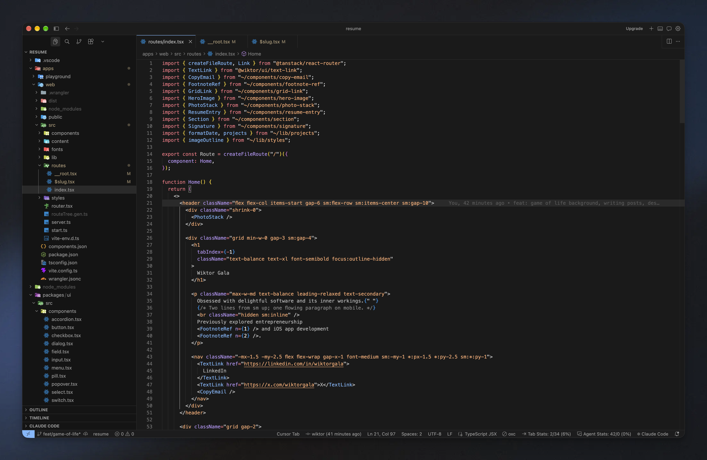

# Min Dark

A minimal VS Code theme, ported from [zed-min-theme](https://github.com/phibr0/zed-min-theme) by phibr0, which is itself inspired by Miguel Solorio's [Min Theme](https://github.com/miguelsolorio/min-theme).



## Variants

| Theme | Description |
| --- | --- |
| Min Dark (Solid) | Dark, opaque title and status bars |
| Min Dark (Blurred) | Dark, translucent title and status bars |
| Min Light (Solid) | Light, opaque title and status bars |
| Min Light (Blurred) | Light, translucent title and status bars |

The Blurred variants are meant for setups that add window transparency or blur to VS Code.

## Install

```sh
git clone https://github.com/vv1ktor/min-dark-theme.git
cd min-dark-theme
npx @vscode/vsce package
code --install-extension min-dark-vscode-0.0.1.vsix
```

Then pick a variant: `Cmd/Ctrl+K Cmd/Ctrl+T`.

## License

[MIT](LICENSE)
